<a href="https://ojas-mohbansi.github.io/ojas-mohbansi/">
  
</a>

  
  
  




<a href="https://github.com/ojas-mohbansi/proto"></a>

  


  

<a href="https://github.com/ojas-mohbansi/nyaya-sahayak"></a>

  

<a href="https://github.com/ojas-mohbansi/omnitutor-ai"></a>

  



  

<a href="https://ojas-mohbansi.github.io/ojas-mohbansi/#experience"></a>


  
  
  
  

<a href="https://ojas-mohbansi.github.io/ojas-mohbansi/">
  
</a>
